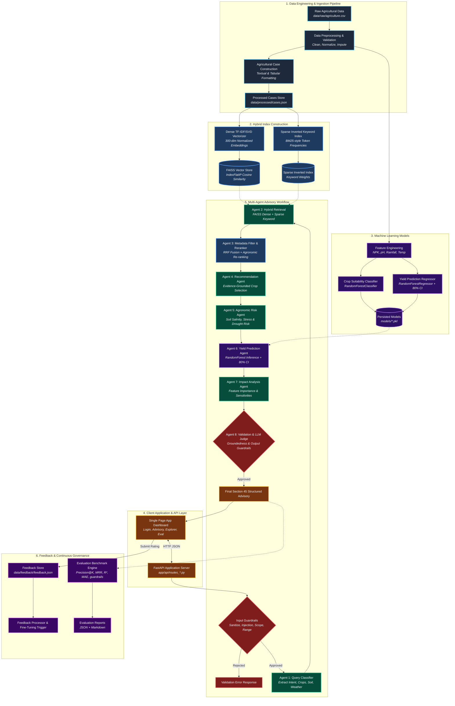

# AI-Powered Agriculture Crop Advisory Assistant — Architecture Specification

## 1. System Architecture Diagram

---

## 2. High-Level Architectural Flow (The 16-Step Pipeline)

1. **Dataset Ingestion:** Raw agricultural records (`data/raw/agriculture.csv` or auto-generated 1,500 synthetic records) ingested with soil, climate, fertilizer, and yield attributes.
2. **Data Preprocessing:** Missing value imputation, outlier handling, agronomic range validation, and feature normalization.
3. **Case Construction:** Transformation of tabular rows into structured semantic documents combining natural language summaries and structured metadata dictionaries.
4. **Vector Embedding:** High-efficiency normalized dense vectorization (TF-IDF/SVD 300 dimensions) encoding agronomic context.
5. **FAISS Vector Index:** `IndexFlatIP` storing normalized embeddings for exact inner-product (cosine) similarity at sub-millisecond speeds.
6. **Keyword Inverted Index:** Lexical inverted index with BM25-style term-frequency inverse-document-frequency weighting for exact tokens (pH, crop names, agro-climatic zones).
7. **Hybrid Retrieval:** Concurrent execution of dense semantic search and sparse keyword retrieval.
8. **Metadata Filtering:** Hard regional and seasonal boundary filtering (`State`, `Season`, `Soil pH`, `Rainfall`).
9. **Re-ranking Engine:** Reciprocal Rank Fusion ($k=60$) coupled with agronomic similarity re-scoring.
10. **Multi-Agent Orchestrator:** Sequential, deterministic pipeline coordinating 8 specialized agents.
11. **Machine Learning Models:**
    - `RandomForestClassifier` for multi-crop suitability probability scoring.
    - `RandomForestRegressor` for expected yield estimation with tree-variance 80% confidence intervals.
12. **LLM Recommendation Synthesis:** Grounded synthesis of agricultural rationale strictly referencing retrieved historical case IDs.
13. **LLM-as-a-Judge Evaluation:** Offline-safe verification of relevance, groundedness, completeness, and safety.
14. **Output Guardrails:** Enforces mandatory agricultural disclaimers ("no future outcome guarantee"), verifies absence of hallucinated chemical recipes.
15. **Final Advisory Delivery:** Section 45 compliant structured JSON payload and rendered Markdown for the user dashboard.
16. **Continuous Feedback & Evaluation:** User star ratings and benchmark suites computing Precision@k, Recall@k, MRR, Hit Rate@k, $R^2$, MAE, and Guardrail pass rates.

---

## 3. Subsystem Breakdown

### Subsystem A: Data & Indexing Layer
- Location: `data/`, `indexes/`, `scripts/`
- Responsibilities: Preprocessing, index persistence, data quality auditing, synthetic record synthesis.

### Subsystem B: RAG & Search Layer
- Location: `app/rag/`
- Responsibilities: Dense vector representation, inverted keyword indexing, hybrid Reciprocal Rank Fusion, metadata constraint enforcement.

### Subsystem C: Machine Learning Layer
- Location: `app/ml/`, `models/`
- Responsibilities: Model training, hyperparameter management, serialization (`.pkl`), confidence interval calculation via ensemble variance.

### Subsystem D: Multi-Agent Pipeline
- Location: `app/agents/`
- Responsibilities: Intent extraction, modular risk analysis, yield extrapolation, recommendation assembly, groundedness auditing.

### Subsystem E: Guardrails & Safety
- Location: `app/guardrails/`
- Responsibilities: Prompt injection regex filters, out-of-domain query classification, numerical physical range checking, output disclaimer enforcement.

### Subsystem F: API & Presentation Layer
- Location: `app/api/`, `frontend/`, `app/main.py`
- Responsibilities: Asynchronous REST endpoints, interactive single-page dashboard with real-time feedback submission and live benchmark runs.

---

## 4. Visual Diagram Files
High-resolution visual diagrams are automatically generated and maintained in:
- `docs/architecture.png` (High-resolution PNG, 300 DPI)
- `docs/architecture.pdf` (Print-ready Vector PDF)
